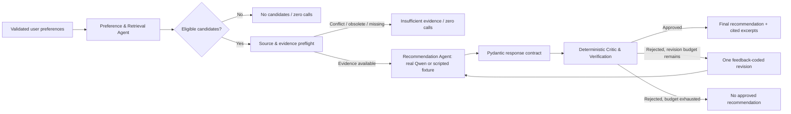

# Evidence-Grounded Multi-Agent Recommendation System

**Applied AI / ML Engineering portfolio · Python · Pydantic · RAG · Qwen2.5 · Gradio · Source Provenance**

A locally runnable recommendation workflow that **retrieves eligible products, generates a sourced proposal, and checks source evidence before accepting it**. It is designed to make model failures, missing evidence, document conflicts, and revision costs **visible and auditable**, not to claim that a small model can reliably fact-check arbitrary prose.

The system has three **functional roles**: **Preference & Retrieval**, **Recommendation**, and **Critic & Verification**. Retrieval and the approval Critic are deterministic Python; **only the Recommendation role** optionally uses a real pinned Qwen language model. There is at most **one revision**.

> **Scope:** All sample products, sources and reference labels are **fictional / author-constructed**. This is an **independent AI engineering portfolio prototype**, not three LLMs cooperating, a real shopping platform, or a validated production semantic fact-checker. A verified local demo is available; there is **no hosted public app**.

## Run the interactive demo

**Python 3.11+**. The guided scenario mode needs no model weights, Hugging Face download or API key:

```bash
git clone https://github.com/Ashley96yy/multi-agent-recommendation-system.git
cd multi-agent-recommendation-system
python -m pip install -e ".[demo]"
python -m recsys.demo.app
```

Open **http://127.0.0.1:7860**. On the **Guided walkthrough** tab, choose one of six **explicitly scripted** cases:

| Walkthrough | Demonstrated engineering behavior |
| --- | --- |
| **Supported source** | Approved fictional recommendation with source ID and verbatim excerpt |
| **One bounded revision** | Initial unsupported clinical phrase is rejected; revised scripted draft may be accepted |
| **Conflicting sources** | Two active documents disagree; fail closed with **zero model calls** |
| **Superseded formulation** | Newer source contradicts obsolete product metadata; zero-call abstention |
| **Missing evidence** | Required attribute has no active documentary source; zero-call abstention |
| **Budget hard-filter** | No eligible candidate exists; no generation needed |

This mode exercises the **real application controller** with **PREWRITTEN JSON proposals**. It **does not run or score a language model**.

For opt-in **real local Qwen CPU inference**, install both extras and choose the second tab:

```bash
python -m pip install -e ".[demo,local-llm]"
python -m recsys.demo.app
```

The pinned public Qwen model is downloaded **only after** an eligible request passes the source preflight. The result might be approved or rejected; rejected drafts remain in the explicitly **unverified trace**, never the final recommendation. The local UI binds to `127.0.0.1` and disables Gradio public sharing.

**Start here:** [Two-minute hiring-manager walkthrough](docs/RECRUITER_DEMO.md) · [Full Gradio guide](docs/stage40_interactive_demo.md) · [Verified Stage 4.0 E2E run](docs/stage40_e2e_results_20261122.md).

## Architecture: how the roles work



The **Critic** checks hard constraints, candidate/evidence ID ownership, required attribute fields, active typed source conflicts, superseding revisions and narrow prohibited-phrase policies. It **does not** automatically establish that every word of an LLM-generated reason is semantically entailed by sources.

**Engineering invariants:** strict input/output contracts; SHA-256 provenance; metadata filters before inference; source conflict/missing/obsolete checks; zero-call early exits; exactly zero or one revision; final-approved output separated from untrusted draft history; original raw model outputs and tokens preserved for evaluation.

[Detailed architecture, module boundaries and limitations](docs/SYSTEM_ARCHITECTURE.md).

## Evidence, not just demos: measured experimental outcomes

This repository preserves both **successful engineering checks** and **negative model-quality findings**. Metrics below refer to **specific synthetic / authored scenarios**, **not real-world recommendation accuracy**.

| Experiment | Recorded outcome | Interpretation |
| --- | --- | --- |
| Retrieval: lexical vs pinned MiniLM | Recall@5 **0.9333 vs 1.0000** on 15 authored retrieval cases | MiniLM ranks this tiny fictional corpus better |
| Real Qwen **Single-Agent** strict baseline | **2/19** positive strict successes; **13/19** generated outputs violated schema | Retrieval alone did not ensure usable generation |
| Original real-Qwen **paired Critic** | **0/19** strict successes for both 0- and 1-revision policies; revision cost **16 extra Qwen calls** | Bounded retry did not improve this strict-policy evaluation |
| Output-format **offline replay** | **2/19 → 12/19** positive author-label successes, **0 new model calls** | Format normalization, **not** new inference or factual checking |
| Real-Qwen **evidence preflight** | Logical calls **19 → 10** while 9 positive requests abstained; matched normalized positive successes **4/19** | Reduces required calls under the preflight policy but not positive success; matched physical calls were shared in the experiment |
| **Typed source** rule audit | **22/22** agreement with authors' engineered typed labels; naive citation-only **8/22** | Deterministic fixture/contract check, **not** human-validated semantics |
| Separate real Qwen **atomic-claim Critic** | **3/26** strict JSON labels valid; **0/26** matched authored labels | Small-model factual classification failed |
| Real Qwen **label constraint** study | Improved prompt **26/26 valid labels**, **8/26** author matches; true token mask changed **0** predictions | Structurally valid output still did not imply correct source judgment |
| **Gradio E2E** and real-model smoke | **6/6 scripted** edge cases, **179 tests** in optional runtime job, **1 real Qwen call** structurally approved | Verified runnable UI, orchestration and one real positive-control integration |

**Comparison caution:** Single-Agent (2/19) and the paired Critic (0/19) apply **different acceptance gates**; those numbers do **not** prove Multi-Agent is worse or better on factual accuracy. The 2/19 → 12/19 format replay did not generate new answers. The Stage 3.3 call reduction describes **logical calls** per policy, not physical calls saved across a combined shared-output matrix. All claims of semantic citation groundedness, independent human-calibrated accuracy, and real-world unsupported-claim rate remain **unmeasured**.

Read the [consolidated final evaluation with precise denominators and original GitHub Actions evidence](docs/FINAL_EVALUATION.md), or inspect the [machine-readable experiment source register](data/portfolio/evidence_register.json).

## Technology and implementation

- **Language and core:** Python 3.11+, Pydantic v2, NumPy, pytest.
- **Retrieval:** deterministic metadata filtering and lexical hashed embeddings for offline demo; separately evaluated pinned `all-MiniLM-L6-v2` for semantic retrieval benchmarks.
- **Generation:** optional pinned `Qwen/Qwen2.5-0.5B-Instruct` through Transformers/PyTorch, greedy CPU inference; fixed JSON test doubles for reproducible offline scenarios.
- **Evidence provenance:** product-linked citations, verbatim source excerpts, effective dates, supersession relationships, explicit typed claims, catalog/source SHA-256 binding.
- **Verification and control:** bounded revision feedback, hard constraints, evidence preflight, deterministic Critic issue codes and opt-in **format-only** JSON normalization that never changes IDs, claims or citations.
- **Interface:** Gradio Blocks on localhost with approved final response, retrieval candidates, source issues, citation excerpts, token/call metrics and unverified revision trace.
- **Evaluation:** pinned model revisions, real GitHub Actions CPU inference runs, raw JSON artifacts, offline replay, label-coverage/latency/call tracking and blank independent-review packets.

### Test and reproduce

```bash
python -m pip install -e ".[dev]"
python -m pytest

# No model needed: six end-to-end scripted control-flow checks
python -m recsys.demo.checks \
  --output artifacts/evaluation/stage40-demo-e2e.json

# Optional real model smoke (downloads pinned public Qwen weights)
python -m pip install -e ".[dev,local-llm]"
python -m recsys.demo.checks --real-qwen-smoke \
  --output artifacts/evaluation/stage40-real-qwen-smoke.json
```

The main CI runs the offline tests. Independent opt-in workflows preserved the actual Qwen/Gradio experiment outputs and evidence, including [the Stage 4.0 recorded CI and real-model smoke](https://github.com/Ashley96yy/multi-agent-recommendation-system/actions/runs/45063616834).

## Project status, limitations and interview narrative

**Portfolio demo complete:** a working local interactive application, reproducible source-control edge cases, a pinned real-model integration, defensive evidence checks, and honest experimental reports. **Not completed:** real product integration, hosted authentication/deployment, independent human semantic-claim adjudication, broad end-to-end accuracy validation or robust LLM factual verification.

The most important lesson: **a valid schema or linked citation is not a guarantee of factual support**, and **a model retry cannot create missing evidence**. The runtime uses the reliable typed deterministic source guard as the hard approval authority, while keeping the separate experimental LLM Critic's negative results visible.

[Recruiter walkthrough](docs/RECRUITER_DEMO.md) · [Full evaluation](docs/FINAL_EVALUATION.md) · [Architecture](docs/SYSTEM_ARCHITECTURE.md) · [Local demo manual](docs/stage40_interactive_demo.md) · [All original experiment docs and provenance](docs/PROVENANCE.md)

### Independent implementation

This is an **independent portfolio implementation** inspired by the SJSU DATA 298A Team 5 Topic 22 research direction; no team-owned code/data/checkpoints were copied into this repository. See [provenance and reuse policy](docs/PROVENANCE.md). The synthetic product examples are demonstrations and do **not** substantiate real skincare or medical efficacy claims.
