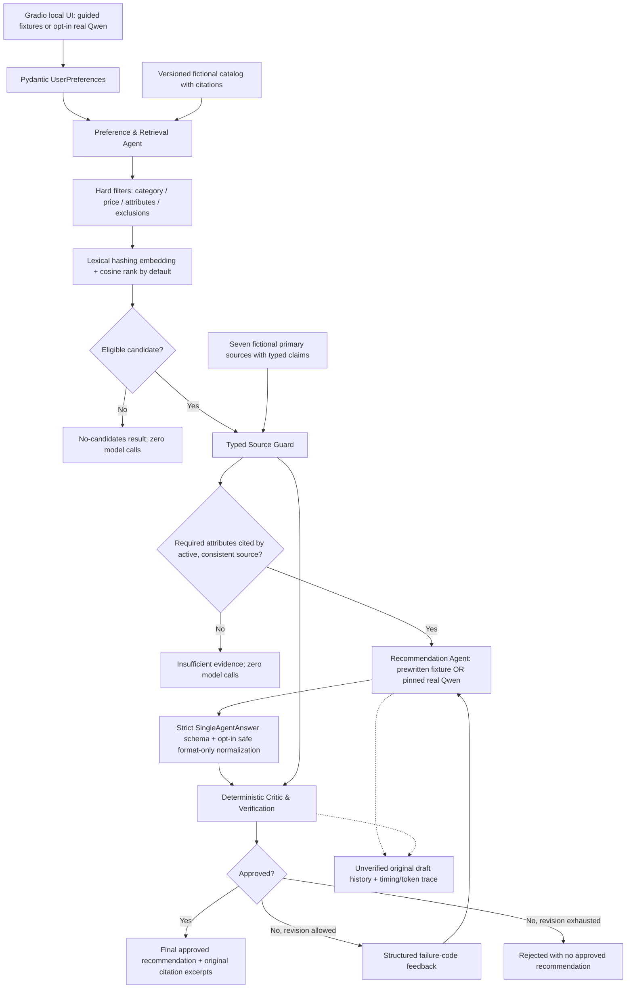

# System Architecture — Functional Agents, Evidence Boundaries and Fail-Closed Control

**Project:** Evidence-Grounded Multi-Agent Recommendation System · **Scope:** local portfolio prototype over fictional product/source data.

This project has **three engineering roles**, not three autonomous language models. Retrieval and the approval Critic are deterministic Python; a pinned local Qwen model performs candidate-recommendation generation in opt-in real inference mode. The Gradio guided walkthrough injects clearly identified **prewritten JSON test fixtures**, not generative predictions.

## Current end-to-end architecture

The word **Agent** denotes a composable system role. This diagram is intentionally explicit about deterministic components and the single optional language model.

## Runtime components and responsibilities

| Module | Main contract / control | Failure behavior |
| --- | --- | --- |
| `recsys.schemas.contracts` | Strict Pydantic `UserPreferences`, `Catalog`, `Product`, `EvidenceReference` | Invalid inputs/data fail before model generation |
| `recsys.retrieval.retriever` | Metadata hard filtering followed by embedding similarity ranking; one `RetrievalResult` | No eligible items → `no_candidates`, no generator |
| `recsys.multiagent.source_guard` | Catalog SHA binding, source provenance and typed field consistency, active conflict / supersession / stale metadata | Ineligible/contradictory/missing source fields → preflight abstention |
| `recsys.multiagent.agents.RecommendationAgent` | Factual context + optional structured revision feedback | Model output considered *untrusted* until validated |
| `recsys.multiagent.orchestrator` | One initial attempt, **at most one** revision; strict `MultiAgentResult` | Exhausted attempts → `rejected`, final answer is `None` |
| `recsys.multiagent.agents.CriticVerificationAgent` | Product membership, exclusions, cited evidence ownership, explicitly required attribute citations, typed source guard and narrow prohibited-phrase checks | Reject on detected violations; returns bounded issue codes |
| `recsys.multiagent.output_policy` | Optional exact Markdown fence strip and insertion of an unequivocal missing `no_suitable_match=false` | Never changes claim text, IDs, prices or citations |
| `recsys.demo.service` | Shared source-guarded controller plus request-by-request actual call/tokens trace | Rejects result drift in scripted demos, never exposes rejected draft as final |
| `recsys.demo.app` | Gradio on `127.0.0.1`, no public share link; separate scripted/real tabs | Clear provenance labels and withheld unapproved recommendation |

## Evidence and decision guarantees

**Guaranteed by implementation and offline tests:**

- Hard constraints are applied before generating; invalid budget/category/product exclusions cannot bypass retrieval rules.
- Source checks consider explicit manually annotated fields, active source disagreements and superseding source records; they can stop **before** the model is loaded.
- Citations are linked to catalog product/source IDs, and the typed source guard can reject wrong-field, cross-product and superseded evidence. The system binds source checks to the expected catalog SHA-256.
- Accepted recommendations are never returned when the final deterministic Critic has unresolved issues. Original rejected drafts are kept only in an explicitly **UNVERIFIED** trace, useful for audit/debugging.
- A revision has a strict upper bound of one; no hidden prompt retry loop, no uncapped agent chain.
- The `LocalQwenGenerator` uses an explicit model revision SHA; model weights are loaded lazily for eligible requests and are not needed by the guided walkthrough.

**Not guaranteed, and never claimed:**

- Every sentence in the model's free-text reason is semantically entailed by cited documents. A valid citation ID is not proof of factual support.
- That an annotated fictional product claim is true for any real retail product, or that a fictional efficacy statement supports clinical outcomes.
- That the separate experimental `recsys.evaluation.model_critic` / `label_constraints` four-label classifier is a reliable automatic runtime guard. It is **not wired into the acceptance path**; the 0.5B model's strict classifier did poorly on authored cases.
- Human-calibrated claim correctness, online generalization, API dollar cost, hosting or public authentication.

## Why the explicit deterministic verifier is the primary acceptance gate

A hard budget/category exclusion or a specific source-version contradiction is a **precisely checkable property**. In the controlled experiments, the small Qwen model sometimes failed formatting and four-way semantic classification even after one revision or prompt changes; allowing that model to override verified conflict state would weaken the system's safety invariant. Therefore the production-style demo uses source-version rules to **fail closed** when the required typed data is not trustworthy, and leaves unassessed natural-language semantics visible as unverified.

The independent reference reports show:

- [Stage 3.1: paired real-Qwen revisions do not improve strict synthetic success](real_multiagent_qwen_results_20261122.md).
- [Stage 3.3: source preflight reduces logical call requirement, not positive success](stage33_real_qwen_results_20261122.md).
- [Stage 3.6: canonical label compliance improves without reliable semantic classification](stage36_real_qwen_results_20261122.md).
- [Stage 4.0: runnable Gradio app and one real-Qwen E2E smoke](stage40_e2e_results_20261122.md).

## Runtime/environment distinctions

The local UI defaults to **lexical hashed retrieval**, requiring only `numpy` and `pydantic`; Gradio is optional via `.[demo]`. The historical 25-case benchmark uses the **pinned MiniLM semantic embedding model** instead. The two retrieval settings have different evidence contexts and should not be compared as if they were the same experimental arm. The Qwen CPU model is an optional extra `.[local-llm]`; it is not required for CI unit tests or the guided deterministic walkthrough.

Model calls, latencies, tokens and raw drafts in live runs are recorded separately from scripted tests. Please do not sum logical counts from shared-draft policy comparison arms as actual billed/physical calls.

Run the [two-minute local walkthrough](RECRUITER_DEMO.md), or examine the [full consolidated evaluation](FINAL_EVALUATION.md).
