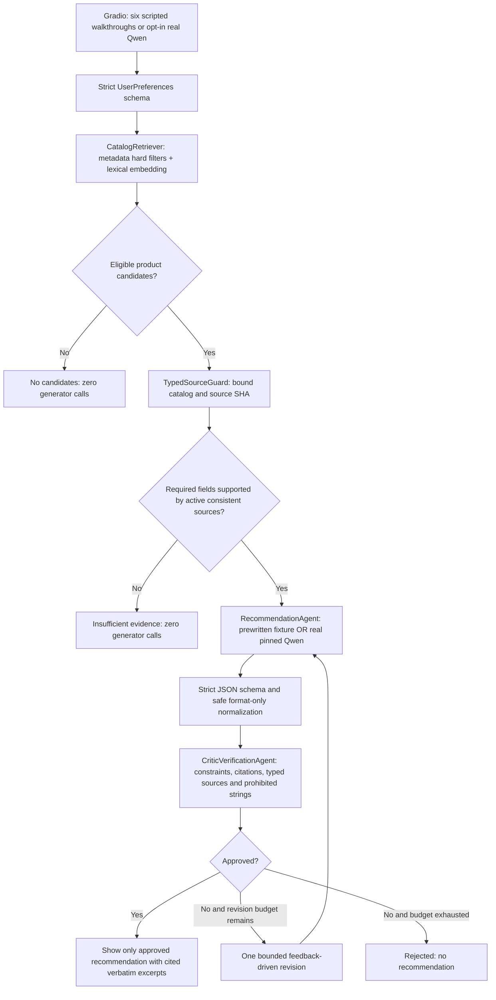

# Stage 4.0 — Interactive End-to-End Multi-Agent Recommendation Demo

**What it is:** A locally runnable **Gradio Blocks** front end, built on
the existing original retrieval → recommendation → deterministic Critic
→ at-most-one revision orchestrator. It uses an independently written
**fictional four-product / seven-document source fixture**, not actual
consumer product data. The UI is a portfolio **engineering demo**, not
a deployed shopping service or validated semantic fact-checker.

## Run the demo locally

Python 3.11+, preferably inside a virtual environment:

```bash
git clone https://github.com/Ashley96yy/multi-agent-recommendation-system.git
cd multi-agent-recommendation-system
python -m pip install -e ".[demo]"
python -m recsys.demo.app --host 127.0.0.1 --port 7860
```

Open **http://127.0.0.1:7860**.

The default **Guided walkthrough** tab does **not** require a GPU,
a model download, network access or an API key. Its model-like
drafts are **PREWRITTEN JSON**, not AI-generated responses. This is
clearly labeled both in the UI and in the trace.

For actual real local inference, additionally install:

```bash
python -m pip install -e ".[demo,local-llm]"
python -m recsys.demo.app --host 127.0.0.1 --port 7860
```

Switch to **Real local Qwen** in the UI. Enter a request and optional
hard filters (category, price, excluded brands/IDs, required boolean
attributes). Select zero or one revision. The **pinned** public
`Qwen/Qwen2.5-0.5B-Instruct` revision
`7ae557604adf67be50417f59c2c2f167def9a775`
downloads from Hugging Face **lazily only if the source preflight allows
model generation**; subsequent local requests can reuse the model in
process memory. The current UI uses CPU inference and a deterministic
lexical hashing retriever, not a paid API, GPU, MiniLM or cloud hosting.
The model may return invalid JSON, abstain or be rejected; the UI does
**not** automatically fake a success.

**Security:** the CLI accepts only `127.0.0.1`; Gradio
`share=False`, no publicly accessible share link, and model requests
are serialized with `default_concurrency_limit=1`. Avoid entering
sensitive information: this is a local development prototype, without
production authentication or secure data storage. Initial public model
downloads may require Internet.

## Architecture



**The source guard is deterministic.** It detects typed source
conflicts, superseded documents, metadata contradictions and missing
attribute declarations. It does **not** automatically extract and
entail every free-text claim made in a recommendation reason. The
Stage 3.6 real 0.5B Qwen model-critic experiment found only **8/26**
author-label agreement, so the experimental semantic LLM critic is
**not the authority for approving demo recommendations**.

## Six deterministic guided walkthroughs

| Scenario ID | What it demonstrates | Expected result | Prewritten proposals |
| --- | --- | --- | ---: |
| `consistent` | Active fictional fragrance-free product specification with verifiable citation ID | `approved` | 1 |
| `revision` | Unsubstantiated clinical phrase rejected by deterministic Critic; one bounded alternative proposal accepted | `approved` after one revision | 2 |
| `conflicting` | Active product spec versus fictional batch QC contradict each other | `insufficient_evidence` | **0** |
| `superseded` | Mineral-sunscreen metadata contradicted by later revised source | `insufficient_evidence` | **0** |
| `missing` | Cleansing product metadata declares fragrance-free with no corresponding actual source declaration | `insufficient_evidence` | **0** |
| `hard_filter` | $5 cap excludes all eligible fictional moisturizers | `no_candidates` | **0** |

The fixed scripts live in `data/demo/walkthroughs.json` with explicit
expected status and call count. The test harness checks these values
after running the **same real Python orchestration code** used by live
Qwen. The scripted JSON examples are not model accuracy measurements.

## Inspectable evidence and trace panels

The UI shows six separate areas:

1. **Final answer:** only recommendations that passed the hard
   constraints, citation ID matching and typed source Critic. No
   rejected model draft becomes a final recommendation.
2. **Call and status metrics:** scripted versus real backend, logical
   attempts, real physical model calls, revision flag, measured real
   prompt and completion tokens (null for scripted), elapsed time.
3. **Retrieval:** filtered candidate IDs, metadata, price/attributes,
   cosine score from the lexical hashing embedder, catalog hash and
   exclusion counts.
4. **Source field diagnosis:** which typed attributes have consistent
   declarations, active-source conflicts, superseded/stale metadata or
   missing evidence.
5. **Verbatim evidence:** product/evidence/source IDs, original
   fictional source excerpts, effective dates and supersession flags.
6. **Explicitly UNVERIFIED draft history:** each generated or
   scripted raw response (including failed ones), JSON/schema validity,
   format-only actions, prompt/context hashes, Critic issue codes and
   revision order. The UI deliberately separates this audit trace
   from the final approved recommendation.

## Reproduce and verify E2E behavior without a browser

Run all project tests and scripted scenarios (no Qwen weights):

```bash
python -m pip install -e ".[dev]"
python -m pytest
python -m recsys.demo.checks \
  --output artifacts/evaluation/stage40-demo-e2e.json
```

When the optional real Qwen runtime is installed, append
`--real-qwen-smoke`. This makes **one real Qwen proposal** on a
single active-source fixture. Its actual status and unmodified raw
response are saved, including if invalid/rejected. This is a backend
smoke check, **not a measure of general real-world semantic accuracy**.

A separate GitHub Actions workflow
`Stage 4.0 Interactive Demo E2E and Real Qwen Smoke` installs Gradio
and Qwen CPU dependencies, constructs the actual UI without exposing
a public port, runs unit tests, exercises all six scripted end-to-end
flows and performs exactly one real Qwen generation. It archives the
entire JSON report including original model output and source hashes.

## Known limitations

The corpus is tiny and intentionally fictional. Pinned lexical hashing
retrieval is not equivalent to MiniLM semantic retrieval; this demo's
engineering goal is auditable control flow. The source guard understands
**manually typed atomic declarations**, not nuanced unrestricted prose.
A valid linked source field does not prove the model's recommendation
reason is semantically faithful. There is no independent human
assessment or real-world product verification.

Model response formatting remains imperfect; the optional
`safe_json_normalization` can remove a complete JSON Markdown fence
and add a missing unequivocal `no_suitable_match=false` flag, but
**never** edits product IDs, reasons, source references, hard constraints
or unsupported clinical statements. A real output can be rejected after
the one permitted revision.

The Gradio app is a **local prototype**, not a deployed server, not
an inventory- or price-backed shopping app and not a complete user
study. Stage 4.1 will prepare final evaluation summaries, recruiter
walkthrough steps, repository polish and explicit performance
limitations.
